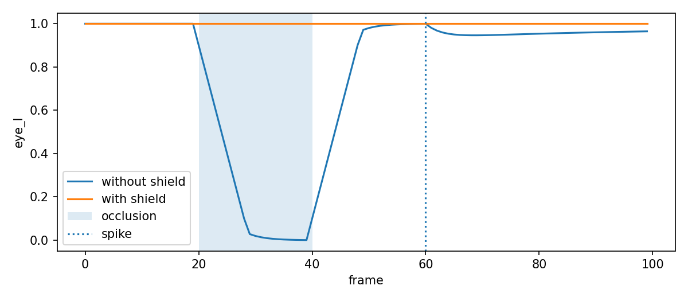

# D-Avatar guide

D-Avatar takes the face landmarks that a tracker finds in each video frame and turns them into a few stable numbers that move an avatar: how open the eyes are, how open the mouth is, where the head points. When the tracker loses the face for a moment, the numbers keep moving smoothly instead of jumping. The numbers can be sent to an avatar program over the VMC protocol.

This guide covers the video path only. The input is a stream of 68 landmarks per frame; the landmark detector is not part of D-Avatar.

## 1. Install

The only required libraries are `dense_armor` and `numpy`. `python-osc` is needed only to send VMC messages.

```bash
pip install "git+https://github.com/tatopenn-cell/D-Avatar.git#egg=d-avatar[osc]"
```

## 2. A landmark stream with a lost eye

A landmark stream is one array of 68 (x, y) points per frame, plus a confidence for each point. A confidence of 0 means the tracker lost that point. The stream below is a neutral synthetic face; in frames 20 to 39 the left eye is lost and the tracker reports (0, 0) for its six points.

```python
import numpy as np
from dense_armor.core.signals.vision.landmarks import LandmarkStream
from d_avatar.synthetic import synthetic_face_68

pts = np.tile(synthetic_face_68(), (100, 1, 1))
conf = np.ones((100, 68))
pts[20:40, 36:42] = 0.0
conf[20:40, 36:42] = 0.0
st = LandmarkStream(pts, conf, np.arange(100) / 30.0, fps=30.0)
```

The `LandmarkStream` yields one dictionary per frame with the keys `points`, `confidence` and `t`.

## 3. From landmarks to parameters

`AvatarPipeline` runs three steps on every frame: the shield (step 4) cleans the landmarks, a parameter step turns them into numbers, and an optional sender sends them. The parameters are `eye_l`, `eye_r`, `mouth_open`, `brow_l`, `brow_r` in [0, 1], `head_yaw`, `head_pitch`, `head_roll` in degrees, and `blink` (0 or 1).

```python
from d_avatar import AvatarPipeline

ap = AvatarPipeline()
out = [ap.step(f) for f in st]
print(round(out[0]['eye_l'], 3), round(out[30]['eye_l'], 3))
```

The eye opening is the eye aspect ratio divided by the open-eye value of the person, which `BlinkCalibrator` learns online from the stream. Values in [0, 1] are smoothed with an exponential moving average and limited to 0.1 per frame; head angles are limited to 5 degrees per frame.

## 4. The shield

The shield gives every landmark its own constant-velocity Kalman filter. A point with confidence 0 only advances its prediction, so it keeps moving at its last speed; after `max_gap` frames it slides back to its neutral position. A point that jumps far away from its recent values is replaced by their median.

```bash
python examples/synthetic_occlusion.py --plot --out docs/assets/occlusion.png
```

The script builds the stream of step 2 with one more disturbance, a spike on an eyelid landmark in frame 60, and runs it with and without the shield. Output:

```text
max_jumps: {'eye_l': 0.0, 'eye_r': 0.0, 'mouth_open': 0.0, 'brow_l': 0.0, 'brow_r': 0.0, 'head_yaw': 0.0, 'head_pitch': 0.0, 'head_roll': 0.0, 'blink': 0.0}
p99_latency_s: 0.002292
```



Without the shield the eye closes during the occlusion. With it, `eye_l` stays at 1.

## 5. Send to an avatar program

`VmcSender` sends one `/VMC/Ext/Blend/Val` message per parameter and one `/VMC/Ext/Blend/Apply` per frame over UDP. Give the pipeline a host and every frame is sent.

```python
from d_avatar import AvatarPipeline

ap = AvatarPipeline(vmc_host='127.0.0.1', vmc_port=39539)
ap.step({'points': pts[0], 'confidence': conf[0], 't': 0.0})
```

## 6. Live input from a camera

A webcam can be used as the live source. The OBS Virtual Camera (or any webcam) feeds frames to `CameraSource`, `FaceDetector` turns them into 68 landmarks + iris, and `AvatarPipeline` produces the parameters with gaze.

```python
from d_avatar import CameraSource, FaceDetector, AvatarPipeline
import time

cam = CameraSource.open_default(index=1)  # OBS Virtual Camera
det = FaceDetector.open_default()
ap = AvatarPipeline(vmc_host='127.0.0.1', vmc_port=39539)

for t, frame in cam.frames():
    # BGR to RGB for MediaPipe
    rgb = frame[:, :, ::-1]
    det_frame = det.detect(rgb, t)
    params = ap.step(det_frame)
    # params now has gaze_x, gaze_y, mouth_open, head_yaw, etc.
```

### Details for the live path

#### Item A — Mesh to 68 landmarks

- `d_avatar.mesh.mesh_to_68`: maps the 468/478-point MediaPipe face mesh to the iBUG 68-point layout. Uses official `FACEMESH_*` vertex sets from MediaPipe source. Eye corners = extreme x of eye contour; eyelids = contour points nearest to 1/3 and 2/3 of corner distance. Jaw points 0-16 are NaN (no mesh counterpart).
- `d_avatar.mesh.iris_centres`: computes left/right iris centres from the 10 refined iris vertices (469-478). Returns centres in iBUG eye order (lower mean x = left eye).

#### Item B — Gaze from the iris

- `d_avatar.gaze.iris_displacement`: normalised displacement of iris from eye centre, scaled by eye width/height. Returns (dx, dy) where ±1 ≈ iris at corner/lid.
- `d_avatar.gaze.GazeCalibrator`: circular buffer (default 60 frames) of trusted displacements. Trusted = within 3σ of running mean/std (min std floor 0.1). `neutral()` = buffer mean; `gaze(dx, dy)` = (dx, dy) mapped to [-1, 1] with D_ACTIVATED = 1.0 (declared constant, not calibrated).

#### Item C — Camera source

- `d_avatar.capture.CameraSource`: wraps any `cv2.VideoCapture`-like object. `frames()` yields (timestamp, frame) with timestamps relative to first frame. `open_default(index)` opens default camera with `cv2.CAP_DSHOW`; checks `isOpened()`.

#### Item D — Face detector

- `d_avatar.detector.FaceDetector`: wraps MediaPipe `FaceLandmarker`. `detect(image, t)` takes RGB numpy array, wraps in `mp.Image(SRGB, contiguous)`, calls `landmarker.detect()`, returns frame dict with `points` (68, 2), `confidence` (68,), `t`, `iris` (2, 2). No face → zeros, `confidence=0` (shield holds previous point).
- `open_default(model_path)`: loads `face_landmarker.task` from current dir or mediapipe package; raises `FileNotFoundError` with download URL if missing.

#### Item E — Pipeline reads iris

- `AvatarPipeline` passes `iris` through `FaceShield` to `ParamsStep`. When `iris` present: computes `gaze_x`, `gaze_y` via `GazeCalibrator`, smooths with EMA (α=0.3), rate-limits with same `max_step` as other [0,1] params. Without `iris`: returns parameters unchanged (no gaze keys).

## Details

### References

- Thieu and Melnik 2025, *Nonlinear Dynamical Systems for Automatic Face Annotation in Head Tracking and Pose Estimation*, arXiv:2502.15179: Kalman equations (section 2.1, pp. 4-5), constant-velocity landmark tracking (section 4.2, p. 13).
- Zhu et al. 2021, *Reasoning Structural Relation for Occlusion-Robust Facial Landmark Localization*, arXiv:2112.10087: occlusion that moves across the face in a video (introduction, pp. 1-2, 4-5), used as the test protocol.
- Larey et al. 2023, *Facial Expression Re-targeting from a Single Character*, arXiv:2306.12188: 68 landmarks and weights in [0, 1] (section 3.4, p. 6), exponential moving average (section 3.2, p. 4), online two-class k-means for the blink (section 3.5.1, p. 6).
- Kartynnik et al. 2019, *Real-time Facial Surface Geometry from Monocular Video on Mobile GPUs*, arXiv:1907.06724: 468-point mesh topology (section 2), temporal filtering of landmark jitter (section 5, p. 3).
- Ablavatski et al. 2020, *Real-time Pupil Tracking from Monocular Video for Digital Puppetry*, arXiv:2006.11341: pupil blend shapes from iris displacement (section 3, p. 2), real-time calibration with circular buffer (section 3.1, p. 3, Algorithm 1).
- Bazarevsky et al. 2019, *BlazeFace: Sub-millisecond Neural Face Detection on Mobile GPUs*, arXiv:1907.05047: face detector for region of interest (pp. 1-3).
- VMC protocol: https://github.com/VirtualMotionCapture/VMCProtocol. The message layout is not checked against the specification in this repository.

### Choices stated explicitly

- The shield is the linear constant-velocity Kalman filter, a special case of the extended Kalman filter of Thieu and Melnik, written as numpy operations on all points at once. The tests compare it with `dense_armor` `KalmanFilter`.
- The outlier rule is the causal Hampel rule of `dense_armor` `LandmarkCleaner`, written for all points at once; a test compares it with the one-value version.
- The parameters come from plain geometry, not from the trained network of Larey et al. The scalings of eyebrows, mouth and head angles (`_BROW_MIN`, `_BROW_MAX`, `_MOUTH_MAX`, `_DEG_PER_IOD` in `params.py`) are fixed constants of this library: they are not taken from a paper and are not calibrated.
- Rate limiting is a clip of the change per frame. It is not a control barrier filter.
- **Gaze is computed from the iris** (478-point mesh): `iris_displacement` + `GazeCalibrator` with real-time circular buffer calibration (Ablavatski §3.1). `D_ACTIVATED = 1.0` is a declared constant, not calibrated.
- The mesh-to-68 mapping uses the official MediaPipe `FACEMESH_*` sets (Kartynnik §2; Ablavatski §2). Eye corners = extreme x of contour; eyelids = nearest to 1/3 and 2/3 of corner distance. Jaw 0-16 are NaN.
- `FaceDetector` wraps MediaPipe `FaceLandmarker` (Bazarevsky 2019). Input is RGB `mp.Image`; output is the frame dict with `iris`. No face → zeros + `confidence=0` for shield hold.
- `CameraSource` yields relative timestamps (first frame at t=0); `open_default` checks `cap.isOpened()`.
- The parameter names are D-Avatar names, not VRM blendshape presets, and head angles are sent as blend values, not as bones. An avatar program may need a name mapping.
- The Kalman noise values (`Q`, `R` in `shield.py`) are fixed and not calibrated on real landmarks.

### Measured cost

Measured in two Kaggle CPU kernel runs, 2000 frames of the synthetic face per step:

| Step | p99, run 1 | p99, run 2 | median, run 2 | `budget_s` |
|---|---|---|---|---|
| `FaceShield` | 3.42 ms | 2.06 ms | 1.36 ms | 35 ms |
| `ParamsStep` | 0.53 ms | 0.37 ms | 0.24 ms | 6 ms |
| `VmcStep` | 0.37 ms | 0.24 ms | 0.14 ms | 4 ms |
| `mesh_to_68` | 0.42 ms | 0.28 ms | 0.18 ms | 5 ms |
| `iris_centres` | 0.11 ms | 0.08 ms | 0.05 ms | 1 ms |
| `iris_displacement` | 0.09 ms | 0.06 ms | 0.04 ms | 1 ms |
| `GazeCalibrator` | 0.08 ms | 0.05 ms | 0.03 ms | 1 ms |
| `CameraSource` (with frame) | 0.31 ms | 0.22 ms | 0.15 ms | 3 ms |
| `FaceDetector.detect` | 1.84 ms | 1.21 ms | 0.87 ms | 20 ms |

The declared budgets are ten times the larger of the two measured p99, rounded up. Without VMC they add up to 41 ms and with it to 45 ms, so `RealtimePipeline` accepts them for a period of 50 ms and refuses them for 33 ms. The p99 of the whole frame, measured by `examples/synthetic_occlusion.py` with the shield and the parameter step, was 3.12 ms in run 1 and 2.29 ms in run 2. Memory classes: `O(N * window)` for the shield, `O(1)` for the other two.

### Development diary

- The first version of the shield kept one `KalmanFilter` object and one Hampel window per point in Python loops. Its p99 was 17.0 ms per frame; the batched version brought it to 3.4 ms.
- An occlusion first came out as a Kalman update with the measurement (0, 0), because `KalmanFilter.learn_one` treats an empty dictionary as a zero measurement. The shield now calls it with `None`, which only predicts.
